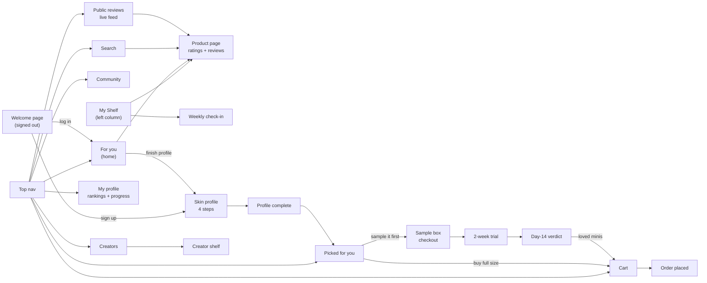
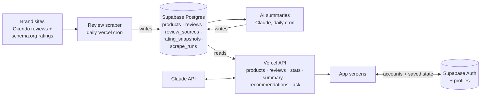

# DEW

DEW is a skincare web app that matches you with people who share your skin, climate and goals, then picks, samples and tracks a routine for you.

Live site: https://dew-skincare.vercel.app (Vercel; every push to `main` deploys)

**Review data**


These counts are live: the badges read [`/api/stats`](https://dew-skincare.vercel.app/api/stats) and refresh about once an hour as the daily scrape adds reviews. Products without reviews have a star rating only, or nothing published yet.

## What works

- **For you:** your top 3 picks, a Picked for you banner and refill reminders. Running low only offers Refill, which adds the product to your cart and then reads "Added to cart". Only the middle column shows a scrollbar.
- **My shelf:** tap a product to see weeks used, your rank and score, rate it (lime stars when picked, white outlines when not), log a refill or ask Dew. New accounts start with an empty shelf.
- **Skin profile:** four onboarding steps with profile strength and points: (1) age and skin, (2) environment and day-to-day lifestyle (time outdoors, sleep, stress, diet, hydration), (3) goals, (4) current shelf. You type where you live, and DEW looks up that place’s humidity and UV (30-day averages) and shows them as two chips, e.g. "Humid: 74% humidity" and "High UV: UV 7.4", once a place is found. The shelf step starts empty and shows each product’s photo as you add it.
- **Creators and Community:** creator shelves with rankings by category and purpose; a friends-only feed with a collapsible filter and sort panel.
- **Picked for you:** a full-size 4-step routine you can swap and add to the cart, or **Sample it first** with three minis paid for with points.
- **Cart and checkout:** refills, swaps and routine picks in one order, with points redemption (500 pts = $5 off).
- **Sample box flow:** 1,500 pts unlocks a free sample box, then a 2-week trial and a day-14 verdict that moves loved minis to full size with the sample value taken off.
- **Weekly check-in and profile:** skin health, product ratings, buy or don't buy, progress tracker, rankings, challenges and milestones.
- **Ask Dew:** a chat assistant that sits as a button in the bottom-right corner and expands.
- **Accounts:** a welcome page for visitors, plus sign-up and log-in (Supabase Auth). New accounts go straight into the skin profile; each account's points, shelf, cart and check-ins are saved to its profile. Without an account you can still search products, read reviews and browse Public reviews.
- **Your top 3 picks:** on For you, three products chosen from real review data: how highly people with your skin type rate them, which routine step they fill, and whether reviewers say they help your concerns. Each shows "What this solves", "What people like you are saying" (with quotes from people with your skin type), and links to all reviews.
- **AI review summaries:** each product page has "What reviewers say", a Claude-written overview with pros and cons from up to 150 reviews.
- **Public reviews:** a live feed of every collected review, searchable, filterable by product, skin type and rating, and sortable.
- **Ask Dew:** a real chatbot (Claude) for signed-in users that uses your skin profile, your shelf and DEW's review summaries.
- **Shelf + Want to try:** search suggests products from the whole 18,579-product catalog as you type and adds them to your shelf; "Save" puts products in the Want to try list on the right.
- **Live reviews:** every product has a page (`#/product/<id>`) with its star rating on each site that reviews it and real reviews you can filter by skin type. "What people like you are saying" shows the newest reviews from people with your skin type, and picks and search show live star ratings.

Points, cart, ratings and check-ins are saved in your browser (localStorage). Use **Reset demo data** at the bottom of the profile tracker to start over, and **Demo: jump to 1,500 pts** to see the sample box unlock.

## Information architecture

### Screens



### Data



- **Global:** the top nav and Ask Dew are on every page. On desktop the left column (check-in and My Shelf), the middle column and the right column each scroll on their own; below 820px wide everything stacks into one column.
- **Discover** is where people find products: personalized picks, creators with similar skin, the friends feed, search, and a page per product with live ratings and reviews.
- **Skin profile** is four onboarding steps. Finishing them unlocks Picked for you.
- **Picked for you** builds a 4-step routine to buy full size, or to sample first with points.
- **Buy** covers cart and checkout, plus the sample box flow: checkout, a 2-week trial, and a day-14 verdict.
- **Track** is the weekly check-in and your profile, with your rankings, progress, challenges and milestones.
- **Signed out**, visitors see the welcome page, search, product pages and Public reviews; everything else asks them to sign up or log in.
- **Data:** product ratings, reviews, AI summaries and recommendations come from Supabase through the Vercel API (see [Backend](#backend)). Each account's personal state (skin profile, shelf, points, cart, check-ins) is saved to its Supabase profile.

## Branding

From the Brand guidelines page in the Figma file. The app's CSS tokens are in `css/app.css` under `:root`.

### Logo

The DEW wordmark with its raindrop is the only logo. Use the logo asset (`assets/svg/logo.svg`), never retype it.

- **Clear space:** the height of the raindrop on every side.
- **Minimum width:** 72 px on screen.
- **Backgrounds:** cream/light, forest/dark, primary blue or leaf green.
- **Don't** recolor it outside the palette, stretch it, add effects, or separate the drop from the word.

### Color

Six brand colors, plus a five-step rating scale. Text, borders and white cards stay neutral so type stays readable.

| Role | Name | Hex | CSS token |
|---|---|---|---|
| Primary | Light blue | `#EBF6FB` | `--surface-soft` |
| Secondary | Forest | `#113916` | `--forest` |
| Secondary | Lime | `#CBE942` | `--lime` |
| Secondary | Olive | `#A1A261` | `--olive` |
| Secondary | Pale blue | `#CBDBEA` | `--fill-muted` |
| Secondary | Off-white | `#F7F6F3` | `--canvas` |
| Neutral | Ink (text) | `#141C11` | `--ink` |
| Neutral | Secondary text | `#59604F` | `--ink-2` |
| Neutral | Muted text | `#9A9E92` | `--ink-3` |
| Neutral | Line | `#E2E4DC` | `--line` |
| Neutral | Surface (cards) | `#FFFFFF` | `--surface` |

How the UI uses them: off-white is the page background, light blue is soft surfaces (the shelf, Ask Dew, primary buttons), forest is dark buttons and the hero, lime is highlights and points, and olive is the shelf planks.

**Rating and match scale.** Score rings (0–10) and "__% similar" badges both use this scale. Lime is best and coral is worst.

| Score | Match | Label | Hex | CSS token |
|---|---|---|---|---|
| 9.0–10 | 90%+ | Excellent | `#CBE942` | `--r1` |
| 8.0–8.9 | 80–89% | Great | `#EBEB88` | `--r2` |
| 7.0–7.9 | 70–79% | Good | `#F9D28B` | `--r3` |
| 6.0–6.9 | 60–69% | Mixed | `#FACAC1` | `--r4` |
| Below 6.0 | Below 60% | Poor | `#FF7A63` | `--r5` |

On light backgrounds, scores show as a ring in the scale color around the number.

### Typography

**Geist** (`--sans`) and **Geist Mono** (`--mono`), loaded from Google Fonts. They stand in for ABC Monument Grotesk and Monument Grotesk Mono; both are free and from the same family, so they pair cleanly.

| Style | Font | Size | Used for |
|---|---|---|---|
| Display | Geist Regular | 56 | Hero headlines |
| Heading / Large | Geist Regular | 28 | Page titles |
| Heading / Small | Geist Medium | 15 | Card titles |
| Body | Geist Regular | 13 | Paragraphs |
| Label | Geist Medium | 12 | Product names, form labels |
| Caption | Geist Regular | 11 | Supporting text |
| Overline | Geist Mono Medium | 10 | Uppercase labels and brand names |
| Mono / Button | Geist Mono Medium | 12 | Buttons (uppercase) |
| Mono / Data | Geist Mono Regular | 12 | Scores, points, prices |

### Iconography

Characters mark routine steps and rewards (`assets/svg/`):

- **Hydrate:** serums and toners
- **Cleanse:** cleansers
- **Treat:** actives and patches
- **Protect:** SPF and lip care
- **Flame:** points earned
- **Star:** rewards

Product graphics stand in for products without photos and label shelf categories.

### UI components

- **Buttons:** Primary (light blue) for the main action on a screen, Dark (forest) for commits like Add to shelf, Secondary (white with a border) for everything else.
- **Chips, tags and badges:** chips filter, tags describe a reviewer (e.g. Oily, Humid), and badges show where a review came from (e.g. SEPHORA).
- **Scores:** a score is normalized to /10 from the source rating. Match % compares the reviewer's skin profile to yours.
- **Shelf:** products sit on a plank per routine tier. Hover (or tap) a product to see weeks used, your rank on your shelf, its score and quick actions.

## Backend

### How data flows

```
Browser  →  dew-skincare.vercel.app/api/...  →  Supabase API  →  Postgres
```

- **Reading:** the app calls `/api/products` and `/api/reviews`. Those Vercel functions query Supabase with `@supabase/supabase-js` (which goes through Supabase's API, not a direct database connection) using the read-only anon key. The browser never talks to Supabase directly.
- **Writing:** the daily scrape (`/api/cron/scrape`) writes through the same API with the service role key. Big backfills run from a laptop with `npm run scrape -- --full`, using the keys in a local `.env`.
- **Accounts:** the browser signs in with Supabase Auth directly (using the public anon key from `/api/config`) and reads and writes only its own `profiles` row; row level security blocks everyone else's.
- **AI:** `/api/ask` (Ask Dew) and the summary job call the Claude API (Claude Opus 5.5) from the server with `ANTHROPIC_API_KEY`.
- **Keys:** `SUPABASE_URL`, `SUPABASE_ANON_KEY`, `SUPABASE_SERVICE_ROLE_KEY`, `CRON_SECRET` and `ANTHROPIC_API_KEY` are Vercel environment variables (and in `.env` locally, which is not committed). None of them reach the browser.

### Where data lives

| Where | What |
|---|---|
| **Supabase** (Postgres, project `dew`) | All product and review data: `products`, `review_sources` (each scraped page and its status), `reviews`, `rating_snapshots` (each site's published rating over time), `review_summaries` (AI pros/cons) and `scrape_runs` (a log of every scrape). Accounts in Supabase Auth, with each person's saved app state in `profiles`. |
| **Vercel** | Hosting, the API functions and the daily cron. Stores no data. |
| **GitHub** | Code only. |
| **Your browser** | Your sign-in session, plus a copy of your app state (localStorage). Signed out on localhost with `?demo`, the prototype runs entirely in the browser. |

### Pieces

- **Database:** Supabase (Postgres). Schema in `supabase/migrations/`: products, review sources, rating snapshots, reviews and scrape runs. Public reads, server-only writes.
- **API** (Vercel functions in `api/`):
  - `GET /api/products` and `GET /api/products?id=t28_sos`: products we collect reviews for, with the latest published star rating per retailer. `?id=` also works for catalog-only products.
  - `GET /api/products?q=cerave cleanser`: up to 40 matches from the whole catalog, products with reviews first. Add `&paged=1&offset=40` to get `{ total, products }` and page through every match.
  - `GET /api/reviews?product=t28_sos&skin_type=Combination&q=redness&rating=low&sort=helpful&limit=20&offset=0`: scraped reviews. Every filter is optional.
  - `GET /api/summary?product=t28_sos`: the AI pros/cons summary.
  - `GET /api/recommendations?skin_type=Combination&concerns=Breakouts,Redness&owned=Cleanse,Tone&exclude=…`: the top 3 picks with what each solves and what people like you say.
  - `POST /api/ask`: Ask Dew (signed-in users only).
  - `GET /api/config`: the public Supabase settings the browser needs to sign in.
  - `GET /api/climate?q=Austin, TX`: the place, its humidity, UV and dryness over the last 30 days, from Open-Meteo’s free geocoding and weather APIs.
  - `GET /api/stats`: live counts of reviews, products and brands (drives the README badges).
- **Review scraper** (`scraper/`): collects reviews and star ratings from brand sites. See [How the review scraper works](#how-the-review-scraper-works).

## How the review scraper works

### 1. Which pages get scraped

Every product page the scraper visits is a row in the `review_sources` table. Rows get there in two ways:

- **Whole brand catalogs.** `scraper/stores.json` lists brand stores whose reviews are openly available: Eadem, Tower 28, Anua, Beauty of Joseon, KraveBeauty, Rhode, Versed and Then I Met You. `node scripts/import-catalog.js` reads each store's public Shopify product list (`/products.json`) and keeps only skincare. It drops makeup, sets, minis, refills, merch and gift cards, and keeps one listing when a store lists the same product several times (regional or size variants). It loads each candidate page and keeps the first one that doesn't redirect, since duplicate listings often redirect to the home page. Each product goes into `products` with its page in `review_sources`.
- **Hand-picked pages.** `scraper/sources.json` holds specific pages, including the prototype catalog in `js/data.js`. `node scripts/find-sources.js --write` matches catalog products to store listings by name and adds the confident matches. `npm run seed` loads the file into Supabase.

### 2. When it runs

- **Daily:** Vercel Cron calls `/api/cron/scrape` at 09:00 UTC. It works through up to 60 pages, longest-unscraped first, and stops before Vercel's 5-minute limit. The rest wait for the next day.
- **On demand:** `npm run scrape` runs the same batch from a laptop, and `npm run scrape -- --full` backfills everything.

### 3. Fetching politely

All requests go through `scraper/http.js`, which:

- identifies itself honestly as `DewReviewBot/0.1 (+https://github.com/enyajpan/dew-web)`;
- reads each site's robots.txt and skips anything it disallows;
- waits 3 seconds between requests to the same website, and 1 second for Okendo's review API;
- treats a 401, 403 or 429 response as "this site doesn't want bots" and marks the page `blocked`. It never retries with a disguised user agent or tries to get around bot protection.

### 4. Reading a product page

For each page, `scraper/scrape.js` loads the HTML and picks an approach:

1. **Okendo stores** (`scraper/adapters/okendo.js`). The page names the store's Okendo ID and the product's Shopify ID. Okendo's storefront widget loads reviews from a public endpoint that needs no key, so the scraper calls it the same way, 100 reviews at a time, newest first. Each review includes its rating, title, text, reviewer name, verified status, recommend flag, helpful count and date. Most also include the reviewer's skin type and skin tone, which DEW uses for matching.
2. **schema.org data** (`scraper/adapters/jsonld.js`). Most product pages publish structured data for search engines. The scraper reads the star rating and review count from it, plus any individual reviews it includes.
3. **Other review providers.** If the page uses PowerReviews, Bazaarvoice, Yotpo, Judge.me, Stamped or TurnTo, the review text only comes through that provider's API with the site's key. The scraper keeps the public star rating and marks the page `needs_partnership` rather than using the key.

### 5. Safeguards

- **Redirects:** if a product page redirects somewhere else (often the home page when a product is discontinued or region-locked), the run counts it as an error and saves nothing. Otherwise it could pick up a featured product's reviews.
- **Right product:** Okendo reviews are fetched only for the page's own product ID, never for the first review widget on the page.
- **Rating summaries:** an Okendo star summary is used only when it's the only one on the page, since related-product widgets carry their own.
- **Empty reviews:** reviews with no real text (like "....") are stored but hidden by the API.

### 6. Saving

`scraper/store.js` writes to Supabase with the service role key:

- **Reviews** are upserted on (page, the site's own review ID), so re-scraping never creates duplicates.
- Each product keeps its **newest 1,000 reviews**. After the first full read, daily runs stop as soon as they reach a review already saved, so they only fetch what's new.
- The page's **published rating and review count** go into `rating_snapshots` on every run, which builds a history.
- The page's **status** is updated (`active`, `blocked` or `needs_partnership`) along with the time and any error.
- Every run is logged in **`scrape_runs`**: start and finish times, pages attempted, reviews saved and errors.

### 7. Tagging skin types

So people can filter to reviewers with their own skin, every review gets a `skin_types` list (Combination, Oily, Dry, Normal, Sensitive). A database trigger fills it whenever a review is saved, combining two sources:

- **Reviewer's pick:** some sites (Okendo stores) ask reviewers for their skin type. Their answer is kept as is.
- **Review text:** keyword matching on first-person phrases where reviewers describe *their own* skin: "I have dry, sensitive skin", "my skin is very oily", "as someone with combo skin", "oily-skinned", "skin type: normal". General advice like "great for oily skin" doesn't count. "Oily t-zone", or oily and dry together, counts as Combination.

A reviewer's pick wins over a different type found in the text; Sensitive can be added on top of any type. `skin_type_source` records where the tags came from (`reviewer`, `review text` or both), and review cards mark text-detected types "from review". The rules live in the `detect_skin_types` database function; after changing them, run `sh scripts/backfill-skin-types.sh` to re-tag every review.

### 8. What it can't reach

- **Sephora, Olive Young and Bubble** block automated access.
- **Ulta, Shiseido, and stores using PowerReviews, Bazaarvoice, Yotpo, Judge.me or Stamped** only publish a star rating openly. Their review text needs a data partnership with the review provider (for example Bazaarvoice syndication for Sephora) or a licensed data feed.

### Adding more

- **A whole brand:** check that its store is on Shopify with Okendo reviews, add it to `scraper/stores.json`, then run `node scripts/import-catalog.js` and `npm run scrape -- --full`.
- **A single page:** add `{ "product_id", "retailer", "url" }` to `scraper/sources.json`, then run `npm run seed` and `npm run scrape`.
- **Testing without the database:** `npm run scrape:dry` scrapes `sources.json` into `scraper/out/`.

## Skincare catalog list

The products in it are also loaded into DEW as catalog-only products (searchable and addable to a shelf, no reviews) by `node scripts/import-catalog-csv.js`.

`data/skincare-catalog.csv` lists **18,504 skincare products from 2,112 brands** (November 8, 2026), so you can see which brands and products DEW doesn’t cover yet. It holds products only (no reviews), so it can include stores whose reviews can’t be collected.

- **Columns:** brand, product_name, category (Cleanser, Toner + essence, Serum + treatment, Moisturizer, Sunscreen, Mask, Exfoliant, Eye care, Lip care, Face oil, Body care), sold_at, price_usd, rating, review_count, in_dew_catalog (yes/no), url, image_url.
- **Sources:**
  - **Ulta:** each brand’s skin care page, using the brand list from Ulta’s own sitemap. Gives brand, name, price, rating, review count and photo.
  - **Shopify stores:** the public product list (`/products.json`) of multi-brand shops (Credo, Soko Glam, Peach & Lily, The Detox Market, Wishtrend) and about 60 brand sites that answered (of 130 tried). Sites that aren’t on Shopify or refuse bots are skipped.
  - **Dermstore:** product sitemap. The brand is matched against brands found in the other sources; rows it can’t match get their brand from Dermstore’s brand directory (`node scripts/fill-catalog-brands.js`), and 49 that still can’t be told apart are listed as "Unknown brand".
  - **Open Beauty Facts:** the open product database (ODbL licence), filtered to skincare categories.
- **Filter:** keyword rules on the name and product type keep skincare and drop makeup, hair, fragrance, tools, merch and gift cards.
- **Duplicates:** one row per brand + name. `sold_at` lists every source that carries it.
- **Not included:** Sephora, Olive Young and Amazon refuse automated access. Other big retailers (Target, Walmart, CVS) have no skincare-only listing to crawl, so they’d mean crawling millions of unrelated products.
- **Rough edges:** names come as each store writes them, so sizes, sets and bundles appear as their own rows, and Open Beauty Facts brands are sometimes lowercase.
- **Per source (Nov 8):** Ulta 6,809 · Dermstore 3,408 · Open Beauty Facts 2,859 · Credo 903 · The Detox Market 796 · Soko Glam 471 · brand sites the rest. 108 rows are already in DEW (`in_dew_catalog = yes`).
- **Refresh:** `node scripts/build-catalog.js` (about an hour at 3 seconds per request per site). `--only ulta,shopify` runs some sources, and `--merge` adds them to the existing CSV instead of replacing it.

## Run locally

Needs Node 22+ and a `.env` with `SUPABASE_URL`, `SUPABASE_ANON_KEY`, `SUPABASE_SERVICE_ROLE_KEY`, `CRON_SECRET` and `ANTHROPIC_API_KEY`.

```
npm install
npm run local        # site + API at http://localhost:3000
npm run scrape:dry   # scrape sources.json into scraper/out/ without touching the database
npm run scrape       # scrape due sources into Supabase (add -- --full to backfill)
npm run seed         # load products and review sources into Supabase
node scripts/summarize.js   # write AI summaries for products that need one (--limit=3 to try a few)
```

Open http://localhost:3000/?demo to use the full app without signing in (localhost only).

## Changelog

Newest first. Every major change gets an entry here.

**November 9, 2026: 10 more creators**

- Creators like you now lists 16 creators instead of 6. The 10 new ones (Maya, Jun, Sofia, Dev, Hana, Amara, Elena, Kai, Priyanka, Zoe) cover more skin types and climates, including dry, sensitive, eczema-prone and redness-prone skin.
- Each has a location, age range, skin tags, top 3 products, a holy grail and a shelf built from catalog products, with portraits in `assets/img/people/`.
- Cache versions bumped: `js/app.js?v=35`, `data.js?v=7`.

**November 9, 2026: shelf panel fills the screen height**

- The left column's panel (skin check-in, My Shelf, Running low) now runs the full height of the screen on every page.
- The three sections are spread evenly down the panel with at least 32 px between them, and the "Tap any product…" hint sits at the bottom. On short screens the gaps shrink to 32 px and the column scrolls as before; below 820 px wide the panel goes back to its natural height.

**November 9, 2026: the name is "Dew", not "DEW"**

- Every typed "DEW" on the site now reads "Dew": page title and description, welcome page, checkout copy, order and sample box numbers (#Dew-20481), the Ask Dew system prompt and code comments.
- All-caps labels and buttons (Geist Mono) would still render the name as "DEW", so the name sits in a `.nc` span that keeps its normal case, e.g. "TRACKED PROGRESS: 4 CHECK-INS VIA Dew TRACKER".
- The box front label (`assets/svg/box-front.svg`) was re-exported from Figma as "Dew 4-STEP BOX".
- Figma: 107 text layers, 45 layer and component names (e.g. "Logo / Dew / Dark") and the variable collections (Dew Brand, Dew Radius) were renamed. Three "THE DEW PHILOSOPHY" labels on the Hi-fi v1 moodboard use a trial font that isn't installed, so Figma can't edit them.
- The logo artwork itself still spells the wordmark in capitals; redrawing it is a separate decision.

**November 9, 2026: Ask Dew on every page, in light blue**

- Ask Dew is now pinned to the bottom right of every page: cart, checkout, setup, check-in, product, sample and the signed-out welcome, log in and sign up pages, as well as the pages that already had it. Before, only pages that opted in showed it. Signed-out visitors get the built-in sample answers, as before.
- The pill and the open panel now use the design-system light blue, `--surface-soft` (#EBF6FB), with a pale blue (`--fill-muted`, #CBDBEA) border, instead of the darker #A3D0FE. Dew's replies stay in white bubbles.

**November 9, 2026: Picked for you box now animates**

- The box on Picked for you was a still image of the first frame of the Figma "Box reveal (animated)" component (Hi-fi v7, 186:9796). It is now built from layers and plays the prototype: a 0.8s hold, three 0.12s shakes, the lid flaps swing open, then the four routine products and the characters pop out with a bounce.
- The products in the box are the user's current routine picks, so a swap shows up in the box.
- It plays once each time you open the page. Clicking a filter or swapping a product shows the open box without replaying it. With reduced motion turned on, the open box shows straight away.
- New asset: `assets/svg/box-front.svg` (the front panel and its label, from Figma). The old still image, `routine-box.svg`, was removed.

**November 9, 2026: live site matched to Hi-fi v7 (Figma)**
- Top nav: white background (was off-white), smaller 84 px logo, 12 px tabs in secondary ink, search field on the canvas color, points pill with a border, smaller cart count. The first tab is now "Explore" (was "For you"), and so is the page title.
- Layout: the side columns are now 296 px and 264 px like the Figma, so the middle column is 800 px at 1440 wide.
- Left column: one white "Shelf panel" holds the check-in, My Shelf, Running low and the shelf hint, as in Figma. Running low is compact, with a days-left bar, "Refill $15" buttons and "Replace" for a low-rated product. Finish-your-profile card has a 4-segment progress bar, lime-ring step rows and a 19 px title.
- Explore: hero card has no eyebrow, a 30 px title, Figma copy and "See my routine →". The "Your box" illustration is now the exact vector from Figma (cleanser, toner, moisturizer and sunscreen shapes behind the olive lid), so the icons line up. "2 steps missing →" replaces "Edit profile" until the profile is done. Top 3 picks: 17 px heading, lime gap chip, buy bar with "% say BUY", one quote, no bullet lists, no price on Add to cart.
- Want to try rail: 15 px heading, brand / name / price rows with an "Add to cart" link, and "Add all to cart · total".
- Ask Dew: light blue pill and panel with white Dew bubbles, as in the Ask Dew v5 component.
- Picked for you: light blue cream hero with the "DEW 4-step box" from Figma (assets/svg/routine-box.svg, assets/img/picked-hero.jpg), budget and preference filter chips, step cards labelled "1: Cleanse", "Keep ✓" on the product you already own, a one-button summary bar with "212 tracked routines", and "Show them →".
- Weekly check-in: square scale segments (blue-gray for worse, canvas for better), lime "Part 2" badge, smaller product chips, BUY / DON'T BUY in caps.
- Community: white match banner, 96 px progress photos, 13 px review text, a Share action.
- Public reviews and product page: "View on [brand] ↗" source buttons, 13 px review text, compact filters, "+ Want to try" under Add to cart, dot-separated product details.
- Skin profile: shelf step groups products by routine step (Cleanse + tone, Treat, Moisturize, Protect + lips) and puts Scan barcode and Import orders next to the search field; the strength card shows the three characters.
- My profile: challenge rows get character tiles; upcoming milestones are labelled "NEW:".
- Kept on purpose: the design-system buttons (Dark, Secondary, Lime) instead of the older button frames still on v7, and the current order of the setup steps.

**November 9, 2026: creator cards match Kara's layout (Hi-fi v7 comment)**
- Every card on Creators like you now uses the layout of Kara Lim's card on Hi-fi v7: name with the "% like you" pill beside it, handle and followers, city and age range, separate Skin type and Environment rows, a "Top 3 products" box (holy grail first, highlighted, then two more with brand and score), and Follow / View full shelf.
- Each creator in js/data.js gains `location`, `age`, `skin`, `environment` and `top3` (product id + score), taken from the v7 designs. The shelf preview and the quote moved off the card; they are still on each creator's page.

**November 9, 2026: three button styles, two sizes**
- Buttons now come in three styles: **Dark** for the one main action on a screen, plain **Secondary** for everything else, and **Lime** for the main action on dark green panels and for rewards. The light-blue Primary style is gone: setup "Continue" and the top-bar "Create account" are Dark; "Finish my profile" (profile card) and "Add full sizes to cart" (check-in) sit on dark panels, so they are Lime; "See all reviews" and "Add to shelf + start tracking" sat next to a Dark button, so they are Secondary.
- Two sizes: default (34 px) and `.sm` (28 px). The large size is gone; the welcome page and the sign-up and log-in buttons use the default size.
- Removed `.btn.primary` and `.btn.lg` from css/app.css; added a hover color for Lime.

**November 9, 2026: updated character colors**
- The Cleanse, Treat and Protect characters now match the main components in Figma (Brand guidelines page): Cleanse is pale blue (#CBDBEA), Treat is lime (#CBE942) and Protect is a warmer peach (#F9D28B). Shapes are unchanged.
- Character image URLs carry a version (`?v=2`) so browsers load the new art instead of a cached copy.

**November 9, 2026: four corner radius sizes**
- Corner rounding now uses four CSS variables that match the DEW Radius tokens in Figma: `--radius-sm` 8 px (buttons, inputs, tags, small thumbnails), `--radius-md` 16 px (cards, toasts, panels, photo tiles), `--radius-lg` 24 px (hero banners, modals, large panels) and `--radius-full` (chips, pills, avatars, bars). `--radius` stays as an alias for `--radius-md`.
- Every radius in css/app.css and the inline styles in js/app.js now uses one of these four. The 13 one-off values are gone: 4, 6, 9 and 10 px became 8; 12 and 14 px became 16; 20 px became 24; thin bars and the 999 px pills became full.
- Visible changes are small: buttons and tags are a little rounder, cards and toasts a little rounder, hero banners slightly rounder.

**November 9, 2026: top search bar gets the same dropdown**
- The search bar at the top of every page now uses the shelf step's word-by-word dropdown instead of the browser's suggestion list: words in any order, across the whole catalog, with a photo, brand and name for each match.
- Clicking a match (or arrow keys + Enter) opens that product's page. "See all results" at the bottom, or Enter with nothing highlighted, opens the full search page as before.
- The old browser suggestion list is gone, so the page no longer rebuilds a list of every loaded product on each render.

**November 9, 2026: shelf search finds every catalog product**
- The "What's on your shelf right now?" box (step 4 of the skin profile) now has its own dropdown instead of the browser's suggestion list. The browser list only showed a product when the typed text appeared in it word for word, so "body shop satsuma" showed nothing and Add failed even though search had found 7 matches.
- Each typed word just has to appear somewhere in the brand or name, in any order, across all 18k+ catalog products. Results show a photo, brand and name; click one, or use the arrow keys and Enter.
- Add (or Enter) with no suggestion picked adds the best match from the full catalog, searching again if the dropdown hasn't caught up yet.

**November 8, 2026: more places to shop**
- Where you shop (Preferences + goals step) adds Target, Walmart, Drugstores & Pharmacies, Bluemercury and Other.

**November 8, 2026: setup buttons fit on phones**
- On screens 600px wide or narrower, the setup steps' Continue button wraps its label onto two lines instead of running off the screen, and the Back/Skip button matches its height.

**November 8, 2026: colons in climate chips**
- The location step's climate chips use a colon instead of a semicolon ("Humid: 74% humidity", "High UV: UV 7.4").

**November 8, 2026: tidier Profile strength panel**
- In the setup sidebar's Finish to unlock list, each perk stays on one line, matching Figma. The character icons at the bottom of the panel are gone.

**November 8, 2026: Hydration question**
- "Drinks 2L+ water" moved out of Diet into a new Hydration question below it in Your day-to-day (Under 1L a day, 1–2L a day, Drinks 2L+ water; pick one). Profiles that had it under Diet are moved over automatically.

**November 8, 2026: simpler climate chips**
- The location step shows two climate chips, humidity and UV, with a semicolon instead of a dot ("Humid; 74% humidity", "High UV; UV 7.4"). The air-dryness chip ("Moist air") is gone, since it came from the same humidity number.

**November 8, 2026: every catalog product has a page**
- All 18,504 rows of `data/skincare-catalog.csv` are now DEW products: 18,579 products in total, each searchable with its own product page, reviews or not. The 1,747 Dermstore rows that had no brand got one from Dermstore’s brand directory (`node scripts/fill-catalog-brands.js`); 49 that still can’t be told apart are listed under "Unknown brand".
- Search shows every match: 40 at a time with "Show more" (`/api/products?q=…&paged=1&offset=…`).

**November 8, 2026: product photos fit their frames**
- Product photos shrink to fit inside their thumbnail, shelf and creator-shelf frames, and anything left over is clipped instead of spilling past the container (e.g. the Holy grail card on creator pages).

**November 8, 2026: typed location everywhere**
- Updating your skin profile uses the same typed-location step as sign-up. Profiles saved before the change have their old place looked up automatically, and an old "Humid 74%"/"High UV" chip saved as a location is cleared so you can type your city.
- The profile, Picked for you and For you tags come from your own answers (skin, concerns, the typed place’s humidity, age, diet) instead of fixed Miami sample tags.

**November 8, 2026: For you hero matches Figma**
- The "Too many options? We’ll pick for you." banner matches Hi-fi v7: one-line title (it scales down to stay on one line), text and button stacked on the left, and the Your box illustration with four product shapes on the right.
- The left column has the same gap between How’s your skin today, My Shelf and Running low.

**November 8, 2026: 16,649 catalog products imported**
- Every product in `data/skincare-catalog.csv` that DEW didn’t have is now in `products` as a catalog-only row (`catalog_only = true`), with its category, where it’s sold, its store page and the store’s star rating. 1,747 Dermstore rows without a separate brand were left out. Loaded by `node scripts/import-catalog-csv.js` (safe to re-run after rebuilding the CSV).
- Search, the shelf box and the nav search suggest from all 16,839 products as you type (`/api/products?q=`), and any of them can go on a shelf. Their product pages show where they’re sold and the store’s rating; reviews are only collected for the original 190.
- `/api/products` with no query still returns only the 190 reviewed products, so pages stay fast.

**November 8, 2026: onboarding, For you and a full skincare catalog list**
- Skin profile reordered: age and skin first, then environment, then day-to-day lifestyle. The Lifestyle chips are gone and diet moved into day-to-day.
- Location is typed, not picked. Humidity, UV and air dryness come from the typed place (Open-Meteo, 30-day averages) and only show once it’s found. They also feed the For you tags and Ask Dew.
- New accounts start with an empty shelf. Adding a product on the shelf step puts its photo on the shelf; the fake "Import orders" button is gone.
- For you: removed the "What people like you are saying" section, renamed "Your Top 3 Picks" and "Want To Try" in the My Shelf heading style, Running low only says Refill (then "Added to cart"), scrollbars hidden on the side columns, lime/outlined stars in the shelf’s Rate it.
- `data/skincare-catalog.csv`: every skincare product found at Ulta, Credo, Soko Glam, Peach & Lily, The Detox Market, Dermstore, 100+ brand sites and Open Beauty Facts, for cross-checking what DEW is missing: 18,504 products from 2,112 brands. Built by `node scripts/build-catalog.js` (see [Skincare catalog list](#skincare-catalog-list)).

**November 8, 2026: skin types from review text**
- Every review is tagged with skin types: the reviewer's own pick on the brand site, plus types they describe in their review ("I have dry, sensitive skin"). Filters on Public reviews, product pages and the top 3 picks now include these, so far more reviews match your skin type.

**November 7, 2026: accounts, AI and the Hi-fi v6 comments**
- Welcome page, sign-up and log-in with Supabase Auth. Each account's state is saved to its own profile; signed-out visitors can still search, read product pages and browse Public reviews.
- AI review summaries: Claude (Opus 5.5) writes an overview plus pros and cons for each product from up to 150 of its reviews, always including critical ones. Stored in `review_summaries`. 80 products have one; new summaries are paused for now (the daily summary cron is off). Run `node scripts/summarize.js` to resume, and re-add `/api/cron/summarize` to `vercel.json` to make it daily again.
- Your top 3 picks on For you, from real data: ratings by people with your skin type, routine gaps and your concerns, with "What this solves" and "What people like you are saying" (Hi-fi v6 comment #100).
- Public reviews tab: a live, searchable feed of all collected reviews, filterable by product, skin type and rating, linked to where each was posted (#101, #123), with the live review count.
- Ask Dew answers with Claude, using your profile, shelf and review summaries (#106).
- Product search suggests products as you type and adds them to your shelf; shelf photos blend away white backgrounds (#102). Running low moved under My Shelf (#104, #105); "Save" and a Want to try list (#107, #108).
- Figma: new **Hi-fi v7** page with all 24 v6 comments, including the redesigned Creators grid, creator page (top recommendations, one shelf, All reviews view), profile pages, Public reviews and product page screens. See its “What changed” frame.

**November 7, 2026: backend**
- Moved hosting from GitHub Pages to Vercel (GitHub Pages is turned off). The repo is connected, so every push to `main` deploys.
- Added a Supabase database for products and reviews, and API routes on Vercel that read from it.
- Built the review scraper with a daily Vercel cron. It follows robots.txt, rate-limits itself, and doesn't work around sites that block bots or need a vendor key.
- Imported the full skincare catalogs of 8 brand stores on top of the prototype's 42 products, and backfilled up to 1,000 reviews per product: 56,446 reviews across 152 of 190 products, using 51 MB of the database.
- Removed 38 duplicate store listings that redirect to the home page. The importer now checks each listing's page and keeps the first one that loads, which recovered 31 products that had been hidden behind dead duplicates.
- Wired the app to the live data: a product page with ratings and reviews filtered by skin type, live reviews on For you, and star ratings on picks and search. If the API is unreachable, the app falls back to the sample data.
- Added `/api/stats` (backed by a `review_stats` view in Supabase) and live badges at the top of this README showing review, product and brand counts.
- Safeguards: a product page that redirects elsewhere is treated as an error, reviews are read only for the page's own product, and reviews with no real text are hidden.

## Notes

Product names and photos are real products from brand and retailer sites. Reviews and published star ratings are real, scraped from brand sites. Prices, match scores, match counts, the prototype's sample reviews and creator profiles are still placeholders.
