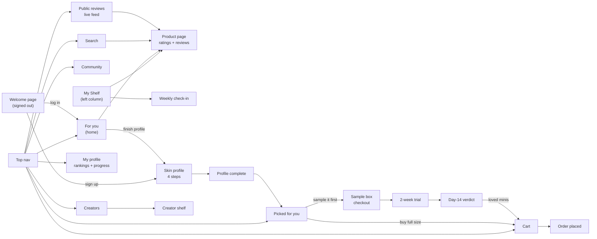
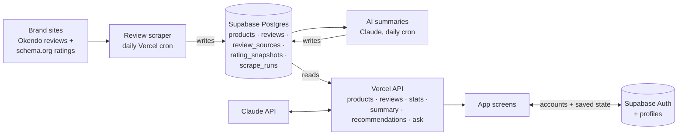

# DEW

DEW is a skincare web app that matches you with people who share your skin, climate and goals, then picks, samples and tracks a routine for you.

Live site: https://dew-skincare.vercel.app (Vercel; every push to `main` deploys)

**Review data**


These counts are live: the badges read [`/api/stats`](https://dew-skincare.vercel.app/api/stats) and refresh about once an hour as the daily scrape adds reviews. Products without reviews have a star rating only, or nothing published yet.

## What works

- **For you:** 10 picks split into "Fills a gap in your routine" and "Want to try something new?", public reviews from people like you, new launches and refill reminders.
- **My shelf:** tap a product to see weeks used, your rank and score, rate it, log a refill or ask Dew.
- **Skin profile:** four onboarding steps (lifestyle, skin, goals, current shelf) with profile strength and points.
- **Creators and Community:** creator shelves with rankings by category and purpose; a friends-only feed with a collapsible filter and sort panel.
- **Picked for you:** a full-size 4-step routine you can swap and add to the cart, or **Sample it first** with three minis paid for with points.
- **Cart and checkout:** refills, swaps and routine picks in one order, with points redemption (500 pts = $5 off).
- **Sample box flow:** 1,500 pts unlocks a free sample box, then a 2-week trial and a day-14 verdict that moves loved minis to full size with the sample value taken off.
- **Weekly check-in and profile:** skin health, product ratings, buy or don't buy, progress tracker, rankings, challenges and milestones.
- **Ask Dew:** a chat assistant that sits as a button in the bottom-right corner and expands.
- **Accounts:** a welcome page for visitors, plus sign-up and log-in (Supabase Auth). New accounts go straight into the skin profile; each account's points, shelf, cart and check-ins are saved to its profile. Without an account you can still search products, read reviews and browse Public reviews.
- **Your top 3 picks:** on For you, three products chosen from real review data: how highly people with your skin type rate them, which routine step they fill, and whether reviewers say they help your concerns. Each shows "What this solves", "What people like you are saying" (with quotes from people with your skin type), and links to all reviews.
- **AI review summaries:** each product page has "What reviewers say", a Claude-written overview with pros and cons from up to 150 reviews.
- **Public reviews:** a live feed of every collected review, searchable, filterable by product, skin type and rating, and sortable.
- **Ask Dew:** a real chatbot (Claude) for signed-in users that uses your skin profile, your shelf and DEW's review summaries.
- **Shelf + Want to try:** search suggests products as you type and adds them to your shelf; "Save" puts products in the Want to try list on the right.
- **Live reviews:** every product has a page (`#/product/<id>`) with its star rating on each site that reviews it and real reviews you can filter by skin type. "What people like you are saying" shows the newest reviews from people with your skin type, and picks and search show live star ratings.

Points, cart, ratings and check-ins are saved in your browser (localStorage). Use **Reset demo data** at the bottom of the profile tracker to start over, and **Demo: jump to 1,500 pts** to see the sample box unlock.

## Information architecture

### Screens



### Data



- **Global:** the top nav and Ask Dew are on every page. On desktop the left column (check-in and My Shelf), the middle column and the right column each scroll on their own; below 820px wide everything stacks into one column.
- **Discover** is where people find products: personalized picks, creators with similar skin, the friends feed, search, and a page per product with live ratings and reviews.
- **Skin profile** is four onboarding steps. Finishing them unlocks Picked for you.
- **Picked for you** builds a 4-step routine to buy full size, or to sample first with points.
- **Buy** covers cart and checkout, plus the sample box flow: checkout, a 2-week trial, and a day-14 verdict.
- **Track** is the weekly check-in and your profile, with your rankings, progress, challenges and milestones.
- **Signed out**, visitors see the welcome page, search, product pages and Public reviews; everything else asks them to sign up or log in.
- **Data:** product ratings, reviews, AI summaries and recommendations come from Supabase through the Vercel API (see [Backend](#backend)). Each account's personal state (skin profile, shelf, points, cart, check-ins) is saved to its Supabase profile.

## Branding

From the Brand guidelines page in the Figma file. The app's CSS tokens are in `css/app.css` under `:root`.

### Logo

The DEW wordmark with its raindrop is the only logo. Use the logo asset (`assets/svg/logo.svg`), never retype it.

- **Clear space:** the height of the raindrop on every side.
- **Minimum width:** 72 px on screen.
- **Backgrounds:** cream/light, forest/dark, primary blue or leaf green.
- **Don't** recolor it outside the palette, stretch it, add effects, or separate the drop from the word.

### Color

Six brand colors, plus a five-step rating scale. Text, borders and white cards stay neutral so type stays readable.

| Role | Name | Hex | CSS token |
|---|---|---|---|
| Primary | Light blue | `#EBF6FB` | `--surface-soft` |
| Secondary | Forest | `#113916` | `--forest` |
| Secondary | Lime | `#CBE942` | `--lime` |
| Secondary | Olive | `#A1A261` | `--olive` |
| Secondary | Pale blue | `#CBDBEA` | `--fill-muted` |
| Secondary | Off-white | `#F7F6F3` | `--canvas` |
| Neutral | Ink (text) | `#141C11` | `--ink` |
| Neutral | Secondary text | `#59604F` | `--ink-2` |
| Neutral | Muted text | `#9A9E92` | `--ink-3` |
| Neutral | Line | `#E2E4DC` | `--line` |
| Neutral | Surface (cards) | `#FFFFFF` | `--surface` |

How the UI uses them: off-white is the page background, light blue is soft surfaces (the shelf, Ask Dew, primary buttons), forest is dark buttons and the hero, lime is highlights and points, and olive is the shelf planks.

**Rating and match scale.** Score rings (0–10) and "__% similar" badges both use this scale. Lime is best and coral is worst.

| Score | Match | Label | Hex | CSS token |
|---|---|---|---|---|
| 9.0–10 | 90%+ | Excellent | `#CBE942` | `--r1` |
| 8.0–8.9 | 80–89% | Great | `#EBEB88` | `--r2` |
| 7.0–7.9 | 70–79% | Good | `#F9D28B` | `--r3` |
| 6.0–6.9 | 60–69% | Mixed | `#FACAC1` | `--r4` |
| Below 6.0 | Below 60% | Poor | `#FF7A63` | `--r5` |

On light backgrounds, scores show as a ring in the scale color around the number.

### Typography

**Geist** (`--sans`) and **Geist Mono** (`--mono`), loaded from Google Fonts. They stand in for ABC Monument Grotesk and Monument Grotesk Mono; both are free and from the same family, so they pair cleanly.

| Style | Font | Size | Used for |
|---|---|---|---|
| Display | Geist Regular | 56 | Hero headlines |
| Heading / Large | Geist Regular | 28 | Page titles |
| Heading / Small | Geist Medium | 15 | Card titles |
| Body | Geist Regular | 13 | Paragraphs |
| Label | Geist Medium | 12 | Product names, form labels |
| Caption | Geist Regular | 11 | Supporting text |
| Overline | Geist Mono Medium | 10 | Uppercase labels and brand names |
| Mono / Button | Geist Mono Medium | 12 | Buttons (uppercase) |
| Mono / Data | Geist Mono Regular | 12 | Scores, points, prices |

### Iconography

Characters mark routine steps and rewards (`assets/svg/`):

- **Hydrate:** serums and toners
- **Cleanse:** cleansers
- **Treat:** actives and patches
- **Protect:** SPF and lip care
- **Flame:** points earned
- **Star:** rewards

Product graphics stand in for products without photos and label shelf categories.

### UI components

- **Buttons:** Primary (light blue) for the main action on a screen, Dark (forest) for commits like Add to shelf, Secondary (white with a border) for everything else.
- **Chips, tags and badges:** chips filter, tags describe a reviewer (e.g. Oily, Humid), and badges show where a review came from (e.g. SEPHORA).
- **Scores:** a score is normalized to /10 from the source rating. Match % compares the reviewer's skin profile to yours.
- **Shelf:** products sit on a plank per routine tier. Hover (or tap) a product to see weeks used, your rank on your shelf, its score and quick actions.

## Backend

### How data flows

```
Browser  →  dew-skincare.vercel.app/api/...  →  Supabase API  →  Postgres
```

- **Reading:** the app calls `/api/products` and `/api/reviews`. Those Vercel functions query Supabase with `@supabase/supabase-js` (which goes through Supabase's API, not a direct database connection) using the read-only anon key. The browser never talks to Supabase directly.
- **Writing:** the daily scrape (`/api/cron/scrape`) writes through the same API with the service role key. Big backfills run from a laptop with `npm run scrape -- --full`, using the keys in a local `.env`.
- **Accounts:** the browser signs in with Supabase Auth directly (using the public anon key from `/api/config`) and reads and writes only its own `profiles` row; row level security blocks everyone else's.
- **AI:** `/api/ask` (Ask Dew) and the summary job call the Claude API (Claude Opus 5.5) from the server with `ANTHROPIC_API_KEY`.
- **Keys:** `SUPABASE_URL`, `SUPABASE_ANON_KEY`, `SUPABASE_SERVICE_ROLE_KEY`, `CRON_SECRET` and `ANTHROPIC_API_KEY` are Vercel environment variables (and in `.env` locally, which is not committed). None of them reach the browser.

### Where data lives

| Where | What |
|---|---|
| **Supabase** (Postgres, project `dew`) | All product and review data: `products`, `review_sources` (each scraped page and its status), `reviews`, `rating_snapshots` (each site's published rating over time), `review_summaries` (AI pros/cons) and `scrape_runs` (a log of every scrape). Accounts in Supabase Auth, with each person's saved app state in `profiles`. |
| **Vercel** | Hosting, the API functions and the daily cron. Stores no data. |
| **GitHub** | Code only. |
| **Your browser** | Your sign-in session, plus a copy of your app state (localStorage). Signed out on localhost with `?demo`, the prototype runs entirely in the browser. |

### Pieces

- **Database:** Supabase (Postgres). Schema in `supabase/migrations/`: products, review sources, rating snapshots, reviews and scrape runs. Public reads, server-only writes.
- **API** (Vercel functions in `api/`):
  - `GET /api/products` and `GET /api/products?id=t28_sos`: products with the latest published star rating per retailer.
  - `GET /api/reviews?product=t28_sos&skin_type=Combination&q=redness&rating=low&sort=helpful&limit=20&offset=0`: scraped reviews. Every filter is optional.
  - `GET /api/summary?product=t28_sos`: the AI pros/cons summary.
  - `GET /api/recommendations?skin_type=Combination&concerns=Breakouts,Redness&owned=Cleanse,Tone&exclude=…`: the top 3 picks with what each solves and what people like you say.
  - `POST /api/ask`: Ask Dew (signed-in users only).
  - `GET /api/config`: the public Supabase settings the browser needs to sign in.
  - `GET /api/stats`: live counts of reviews, products and brands (drives the README badges).
- **Review scraper** (`scraper/`): collects reviews and star ratings from brand sites. See [How the review scraper works](#how-the-review-scraper-works).

## How the review scraper works

### 1. Which pages get scraped

Every product page the scraper visits is a row in the `review_sources` table. Rows get there in two ways:

- **Whole brand catalogs.** `scraper/stores.json` lists brand stores whose reviews are openly available: Eadem, Tower 28, Anua, Beauty of Joseon, KraveBeauty, Rhode, Versed and Then I Met You. `node scripts/import-catalog.js` reads each store's public Shopify product list (`/products.json`) and keeps only skincare. It drops makeup, sets, minis, refills, merch and gift cards, and keeps one listing when a store lists the same product several times (regional or size variants). It loads each candidate page and keeps the first one that doesn't redirect, since duplicate listings often redirect to the home page. Each product goes into `products` with its page in `review_sources`.
- **Hand-picked pages.** `scraper/sources.json` holds specific pages, including the prototype catalog in `js/data.js`. `node scripts/find-sources.js --write` matches catalog products to store listings by name and adds the confident matches. `npm run seed` loads the file into Supabase.

### 2. When it runs

- **Daily:** Vercel Cron calls `/api/cron/scrape` at 09:00 UTC. It works through up to 60 pages, longest-unscraped first, and stops before Vercel's 5-minute limit. The rest wait for the next day.
- **On demand:** `npm run scrape` runs the same batch from a laptop, and `npm run scrape -- --full` backfills everything.

### 3. Fetching politely

All requests go through `scraper/http.js`, which:

- identifies itself honestly as `DewReviewBot/0.1 (+https://github.com/enyajpan/dew-web)`;
- reads each site's robots.txt and skips anything it disallows;
- waits 3 seconds between requests to the same website, and 1 second for Okendo's review API;
- treats a 401, 403 or 429 response as "this site doesn't want bots" and marks the page `blocked`. It never retries with a disguised user agent or tries to get around bot protection.

### 4. Reading a product page

For each page, `scraper/scrape.js` loads the HTML and picks an approach:

1. **Okendo stores** (`scraper/adapters/okendo.js`). The page names the store's Okendo ID and the product's Shopify ID. Okendo's storefront widget loads reviews from a public endpoint that needs no key, so the scraper calls it the same way, 100 reviews at a time, newest first. Each review includes its rating, title, text, reviewer name, verified status, recommend flag, helpful count and date. Most also include the reviewer's skin type and skin tone, which DEW uses for matching.
2. **schema.org data** (`scraper/adapters/jsonld.js`). Most product pages publish structured data for search engines. The scraper reads the star rating and review count from it, plus any individual reviews it includes.
3. **Other review providers.** If the page uses PowerReviews, Bazaarvoice, Yotpo, Judge.me, Stamped or TurnTo, the review text only comes through that provider's API with the site's key. The scraper keeps the public star rating and marks the page `needs_partnership` rather than using the key.

### 5. Safeguards

- **Redirects:** if a product page redirects somewhere else (often the home page when a product is discontinued or region-locked), the run counts it as an error and saves nothing. Otherwise it could pick up a featured product's reviews.
- **Right product:** Okendo reviews are fetched only for the page's own product ID, never for the first review widget on the page.
- **Rating summaries:** an Okendo star summary is used only when it's the only one on the page, since related-product widgets carry their own.
- **Empty reviews:** reviews with no real text (like "....") are stored but hidden by the API.

### 6. Saving

`scraper/store.js` writes to Supabase with the service role key:

- **Reviews** are upserted on (page, the site's own review ID), so re-scraping never creates duplicates.
- Each product keeps its **newest 1,000 reviews**. After the first full read, daily runs stop as soon as they reach a review already saved, so they only fetch what's new.
- The page's **published rating and review count** go into `rating_snapshots` on every run, which builds a history.
- The page's **status** is updated (`active`, `blocked` or `needs_partnership`) along with the time and any error.
- Every run is logged in **`scrape_runs`**: start and finish times, pages attempted, reviews saved and errors.

### 7. What it can't reach

- **Sephora, Olive Young and Bubble** block automated access.
- **Ulta, Shiseido, and stores using PowerReviews, Bazaarvoice, Yotpo, Judge.me or Stamped** only publish a star rating openly. Their review text needs a data partnership with the review provider (for example Bazaarvoice syndication for Sephora) or a licensed data feed.

### Adding more

- **A whole brand:** check that its store is on Shopify with Okendo reviews, add it to `scraper/stores.json`, then run `node scripts/import-catalog.js` and `npm run scrape -- --full`.
- **A single page:** add `{ "product_id", "retailer", "url" }` to `scraper/sources.json`, then run `npm run seed` and `npm run scrape`.
- **Testing without the database:** `npm run scrape:dry` scrapes `sources.json` into `scraper/out/`.

## Run locally

Needs Node 22+ and a `.env` with `SUPABASE_URL`, `SUPABASE_ANON_KEY`, `SUPABASE_SERVICE_ROLE_KEY`, `CRON_SECRET` and `ANTHROPIC_API_KEY`.

```
npm install
npm run local        # site + API at http://localhost:3000
npm run scrape:dry   # scrape sources.json into scraper/out/ without touching the database
npm run scrape       # scrape due sources into Supabase (add -- --full to backfill)
npm run seed         # load products and review sources into Supabase
node scripts/summarize.js   # write AI summaries for products that need one (--limit=3 to try a few)
```

Open http://localhost:3000/?demo to use the full app without signing in (localhost only).

## Changelog

Newest first. Every major change gets an entry here.

**November 7, 2026: accounts, AI and the Hi-fi v6 comments**
- Welcome page, sign-up and log-in with Supabase Auth. Each account's state is saved to its own profile; signed-out visitors can still search, read product pages and browse Public reviews.
- AI review summaries: Claude (Opus 5.5) writes an overview plus pros and cons for each product from up to 150 of its reviews, always including critical ones. Stored in `review_summaries`. 80 products have one; new summaries are paused for now (the daily summary cron is off). Run `node scripts/summarize.js` to resume, and re-add `/api/cron/summarize` to `vercel.json` to make it daily again.
- Your top 3 picks on For you, from real data: ratings by people with your skin type, routine gaps and your concerns, with "What this solves" and "What people like you are saying" (Hi-fi v6 comment #100).
- Public reviews tab: a live, searchable feed of all collected reviews, filterable by product, skin type and rating, linked to where each was posted (#101, #123), with the live review count.
- Ask Dew answers with Claude, using your profile, shelf and review summaries (#106).
- Product search suggests products as you type and adds them to your shelf; shelf photos blend away white backgrounds (#102). Running low moved under My Shelf (#104, #105); "Save" and a Want to try list (#107, #108).
- Figma: new **Hi-fi v7** page with all 24 v6 comments, including the redesigned Creators grid, creator page (top recommendations, one shelf, All reviews view), profile pages, Public reviews and product page screens. See its “What changed” frame.

**November 7, 2026: backend**
- Moved hosting from GitHub Pages to Vercel (GitHub Pages is turned off). The repo is connected, so every push to `main` deploys.
- Added a Supabase database for products and reviews, and API routes on Vercel that read from it.
- Built the review scraper with a daily Vercel cron. It follows robots.txt, rate-limits itself, and doesn't work around sites that block bots or need a vendor key.
- Imported the full skincare catalogs of 8 brand stores on top of the prototype's 42 products, and backfilled up to 1,000 reviews per product: 56,446 reviews across 152 of 190 products, using 51 MB of the database.
- Removed 38 duplicate store listings that redirect to the home page. The importer now checks each listing's page and keeps the first one that loads, which recovered 31 products that had been hidden behind dead duplicates.
- Wired the app to the live data: a product page with ratings and reviews filtered by skin type, live reviews on For you, and star ratings on picks and search. If the API is unreachable, the app falls back to the sample data.
- Added `/api/stats` (backed by a `review_stats` view in Supabase) and live badges at the top of this README showing review, product and brand counts.
- Safeguards: a product page that redirects elsewhere is treated as an error, reviews are read only for the page's own product, and reviews with no real text are hidden.

## Notes

Product names and photos are real products from brand and retailer sites. Reviews and published star ratings are real, scraped from brand sites. Prices, match scores, match counts, the prototype's sample reviews and creator profiles are still placeholders.
